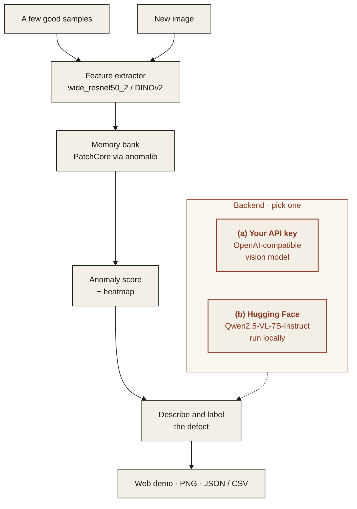

<p align="center">
  
</p>

<p align="center"><em>Find surface defects from a few good samples, with a heatmap of where they are.</em></p>

<p align="center">
  
  
  
  
</p>

---

## Features

- **Few-shot anomaly detection**: learns what "good" looks like from a handful of defect-free images, no defect labels needed.
- **Heatmap overlay**: shows where on the part the anomaly is, with an adjustable threshold.
- **Web demo**: upload an image, get a score and a heatmap.
- **Export**: heatmaps as PNG, scores and regions as JSON or CSV.

> **Data.** Demos will only use datasets whose license permits public demo use, or images we create ourselves. No dataset is bundled in this repository.

## Architecture



### Two interchangeable backends

Pick one with `MS_BACKEND` in `.env`. The rest of the pipeline does not change.

| | (a) Bring your own API key | (b) Open-source on Hugging Face |
|---|---|---|
| **What** | Any OpenAI-compatible endpoint | Open models, run locally or via Hugging Face Inference |
| **Set** | `MS_BACKEND=api`, `OPENAI_BASE_URL`, `OPENAI_API_KEY` | `MS_BACKEND=hf`, `HF_MODE=local` or `inference` |
| **Good for** | Fastest start, strongest hosted models | Data stays on your machines, no per-call cost |

**Default open-source models**

| Model | Used for | License |
|---|---|---|
| [`timm/wide_resnet50_2.tv_in1k`](https://huggingface.co/timm/wide_resnet50_2.tv_in1k) | PatchCore feature backbone | BSD-3-Clause |
| [`facebook/dinov2-base`](https://huggingface.co/facebook/dinov2-base) | alternative feature backbone | Apache-2.0 |
| [`Qwen/Qwen2.5-VL-7B-Instruct`](https://huggingface.co/Qwen/Qwen2.5-VL-7B-Instruct) | describing and labelling the flagged region | Apache-2.0 |
| [anomalib](https://github.com/open-edge-platform/anomalib) | PatchCore implementation | Apache-2.0 |

## Quickstart

> **Coming soon.** The commands below show the planned interface.

```bash
git clone https://github.com/ModelShifts/defect-inspector
cd defect-inspector
cp .env.example .env   # choose a backend
pip install -e .
defect-inspector fit samples/good/
defect-inspector inspect part.jpg --heatmap out/part_heatmap.png
```

## Try it

> **Coming soon.** A hosted demo will be linked here and on [modelshifts.com/work](https://modelshifts.com/work).

## Roadmap

- [x] Repository scaffold and README
- [ ] Few-shot fit on good samples
- [ ] Anomaly score and heatmap
- [ ] Defect description via either backend
- [ ] Web demo
- [ ] Export to PNG, JSON and CSV

## License

[MIT](LICENSE) © Modelshifts Technology Pte. Ltd.

<p align="center"><sub>Part of the <a href="https://modelshifts.com/work">Modelshifts</a> showcase.</sub></p>
