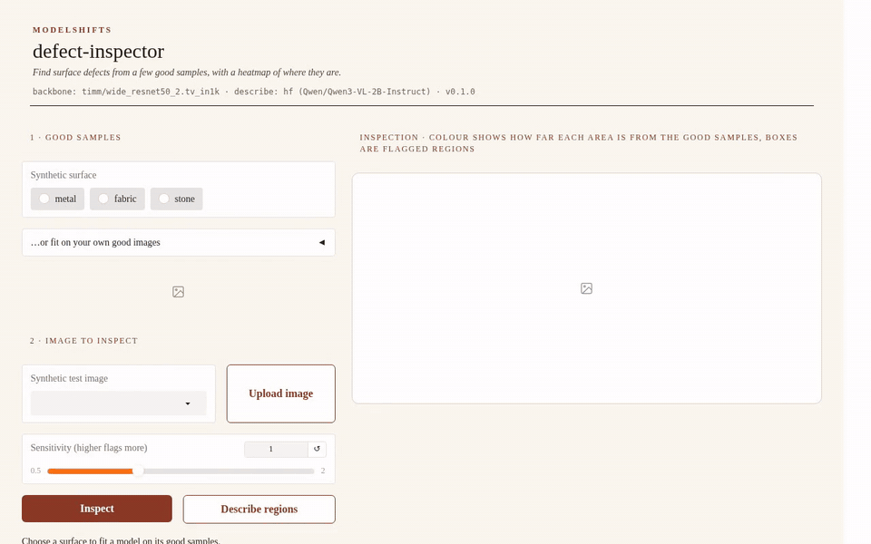
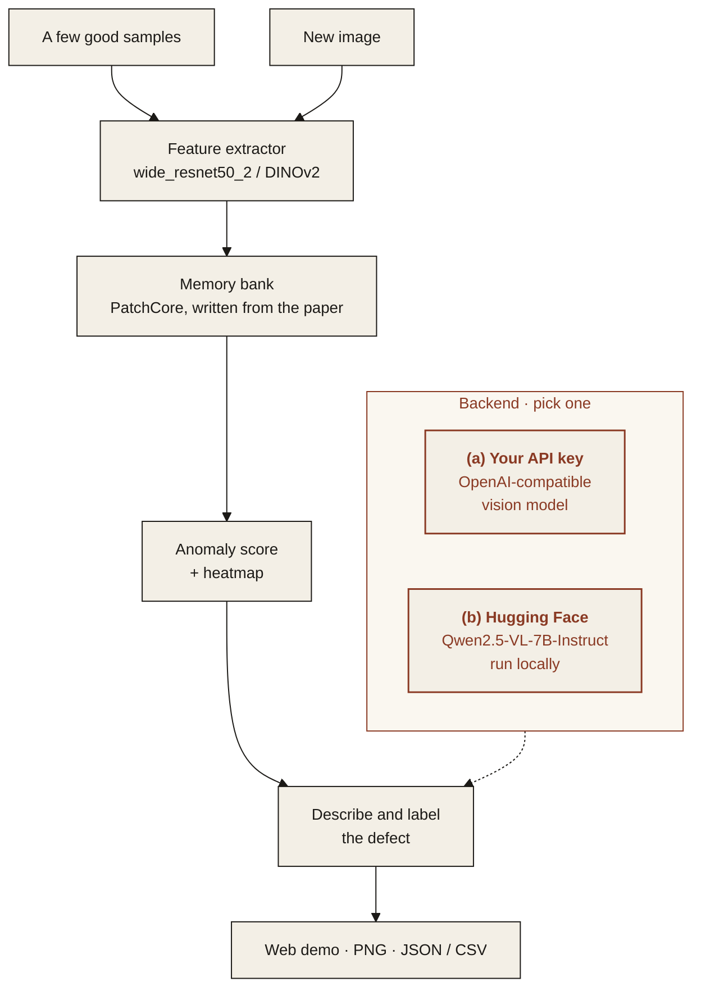

<p align="center">
  
</p>

<p align="center"><em>Find surface defects from a few good samples, with a heatmap of where they are.</em></p>

<p align="center">
  
  
  
  
</p>

---

## Features

All five features below work in v1. See [Limitations](#limitations) for what they do not cover yet.

- **Few-shot anomaly detection**: learns what "good" looks like from a handful of defect-free images, no defect labels needed.
- **Heatmap overlay**: shows where on the part the anomaly is, with an adjustable threshold.
- **Defect description**: optionally, a vision-language model labels each flagged region (scratch, dent, spot, crack or other) and describes it in one sentence.
- **Web demo**: upload an image, get a score and a heatmap.
- **Export**: heatmaps as PNG, scores and regions as JSON or CSV.

<p align="center">
  
</p>
<p align="center"><sub>Web demo on synthetic surfaces (<a href="assets/demo.mp4">MP4</a>). Scores and heatmaps are computed live on CPU. The region descriptions in the recording were computed earlier by Qwen3-VL-2B-Instruct on CPU and loaded from the demo's cache.</sub></p>

> **Data.** All images in this repository are generated by [`scripts/make_samples.py`](scripts/make_samples.py): procedural metal, fabric and stone textures with injected scratches, dents and spots, plus a ground-truth mask for each defect. No third-party dataset is bundled. Public benchmarks such as MVTec AD use the same folder layout and can be used if you download them yourself under their own license (MVTec AD's license does not allow commercial use).

## Architecture



### Two interchangeable backends

Pick one with `MS_BACKEND` in `.env`. The rest of the pipeline does not change.

| | (a) Bring your own API key | (b) Open-source on Hugging Face |
|---|---|---|
| **What** | Any OpenAI-compatible endpoint with a vision model | Open models, run locally with `transformers` |
| **Set** | `MS_BACKEND=api`, `MS_API_BASE`, `MS_API_KEY`, `MS_MODEL` | `MS_BACKEND=hf`, optionally `MS_HF_VLM_MODEL` |
| **Good for** | Fastest start, strongest hosted models | Data stays on your machines, no per-call cost |

The backend is only used to describe flagged regions. Scores and heatmaps always run locally and need no key.

**Default open-source models**

| Model | Used for | License |
|---|---|---|
| [`timm/wide_resnet50_2.tv_in1k`](https://huggingface.co/timm/wide_resnet50_2.tv_in1k) | PatchCore feature backbone | BSD-3-Clause |
| [`facebook/dinov2-base`](https://huggingface.co/facebook/dinov2-base) | alternative feature backbone | Apache-2.0 |
| [`Qwen/Qwen2.5-VL-7B-Instruct`](https://huggingface.co/Qwen/Qwen2.5-VL-7B-Instruct) | describing and labelling the flagged region | Apache-2.0 |
| [`Qwen/Qwen3-VL-2B-Instruct`](https://huggingface.co/Qwen/Qwen3-VL-2B-Instruct) | smaller describer for CPU-only machines | Apache-2.0 |

PatchCore ([Roth et al., *Towards Total Recall in Industrial Anomaly Detection*, CVPR 2022](https://arxiv.org/abs/2106.08265)) is implemented in this repository from the paper: mid-level patch features, a greedy coreset memory bank, and nearest-neighbour distance as the anomaly score. [anomalib](https://github.com/open-edge-platform/anomalib) is not needed.
`MS_BACKBONE=facebook/dinov2-base` (or `facebook/dinov2-small`) switches the feature backbone to DINOv2.

## Quickstart

Python 3.11 or newer.

```bash
git clone https://github.com/ModelShifts/defect-inspector
cd defect-inspector
python -m venv .venv && source .venv/bin/activate
pip install torch torchvision --index-url https://download.pytorch.org/whl/cpu   # CPU build; skip on a GPU machine
pip install -e ".[demo]"          # add ",hf" or ",api" for defect descriptions
cp .env.example .env              # backbone and describe backend
```

The feature backbone (about 270 MB) downloads from Hugging Face on first use.

```bash
# learn "good" from 8 defect-free images
defect-inspector fit samples/metal/train/good --out models/metal.npz

# one image: JSON with score and regions, plus the heatmap overlay as PNG
defect-inspector inspect samples/metal/test/scratch/000.png --model models/metal.npz --heatmap out/scratch.png

# a folder to one CSV (or .json), with a heatmap PNG per image
defect-inspector batch samples/metal/test --recursive --model models/metal.npz --out out/results.csv --heatmaps out/heatmaps

# the web demo at http://127.0.0.1:7860 (python app.py does the same)
defect-inspector serve
```

The score is relative to the fitted threshold: `1.0` is the highest score among the good images, each scored against the others. Above `1.0` the image is flagged. `--sensitivity 1.5` flags more, `0.8` flags less.

### Describing flagged regions

Add `--describe` to `inspect` or `batch`, or press **Describe regions** in the web demo. With `MS_BACKEND=hf` (`pip install -e ".[hf]"`), the default Qwen2.5-VL-7B needs a GPU. On a CPU-only machine set `MS_HF_VLM_MODEL=Qwen/Qwen3-VL-2B-Instruct` and `MS_HF_DTYPE=bfloat16` in `.env` (about 5 GB of memory, a few seconds per region).

With `MS_BACKEND=api` (`pip install -e ".[api]"`), any OpenAI-compatible endpoint with a vision model works:

```bash
MS_BACKEND=api
MS_API_BASE=https://your-provider.example/v1
MS_API_KEY=your-api-key
MS_MODEL=your-vision-model
```

To try it without a paid key, run an open vision model behind [llama.cpp](https://github.com/ggml-org/llama.cpp)'s OpenAI-compatible server (download a prebuilt `llama-server` from its releases page):

```bash
hf download Qwen/Qwen3-VL-2B-Instruct-GGUF Qwen3VL-2B-Instruct-Q4_K_M.gguf mmproj-Qwen3VL-2B-Instruct-Q8_0.gguf --local-dir models
llama-server -m models/Qwen3VL-2B-Instruct-Q4_K_M.gguf --mmproj models/mmproj-Qwen3VL-2B-Instruct-Q8_0.gguf --port 8001
# then: MS_API_BASE=http://127.0.0.1:8001/v1  MS_API_KEY=local  MS_MODEL=qwen3-vl-2b
```

### Samples, tests and evaluation

`samples/` holds three synthetic surfaces (metal, fabric, stone). Each has 8 good training images and 18 test images (6 good, 4 each with a scratch, dent or spot) with ground-truth masks.

```bash
pip install -e ".[dev]"
python scripts/make_samples.py               # regenerate samples/
pytest                                       # uses a stand-in backbone and model, no downloads
python scripts/evaluate.py                   # image and pixel AUROC on the synthetic set
python scripts/evaluate.py --describe        # also checks region labels with the configured backend
```

## Limitations

- The samples are synthetic, with one defect per image on fairly regular textures. The project has not been measured on photos of real parts.
- The threshold comes from the good training images alone (the highest leave-one-out score). With only a few good images it can be too loose or too tight, so the sensitivity slider and `--sensitivity` are there to adjust it.
- Flagged regions follow the smoothed heatmap, so their boxes are larger than the defect itself and are not a segmentation.
- Images are resized to a square (256 px by default). Very small defects on large images may be missed; crop or tile large images first.
- Region labels come from a general vision-language model and can be wrong; on the synthetic set the most common mistake is calling a dent a spot. They are a description to help review, not a classification you can rely on.
- On an 8-core CPU, fitting on 8 images takes a few seconds and scoring takes well under a second per image. Describing a region with Qwen3-VL-2B on CPU takes a few seconds; Qwen2.5-VL-7B needs a GPU.
- The web demo keeps fitted sample models and region descriptions under `.cache/` and reuses them.

## Roadmap

- [x] Repository scaffold and README
- [x] Few-shot fit on good samples
- [x] Anomaly score and heatmap
- [x] Defect description via either backend
- [x] Web demo
- [x] Export to PNG, JSON and CSV
- [ ] Tiling for large images
- [ ] Hosted demo

## License

[MIT](LICENSE) © Modelshifts Technology Pte. Ltd.

<p align="center"><sub>Part of the <a href="https://modelshifts.com/work">Modelshifts</a> showcase.</sub></p>
