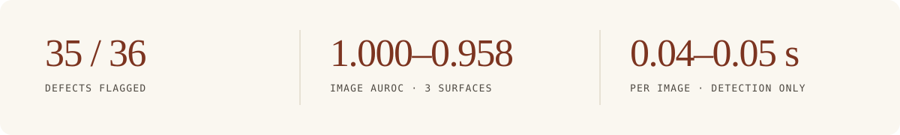
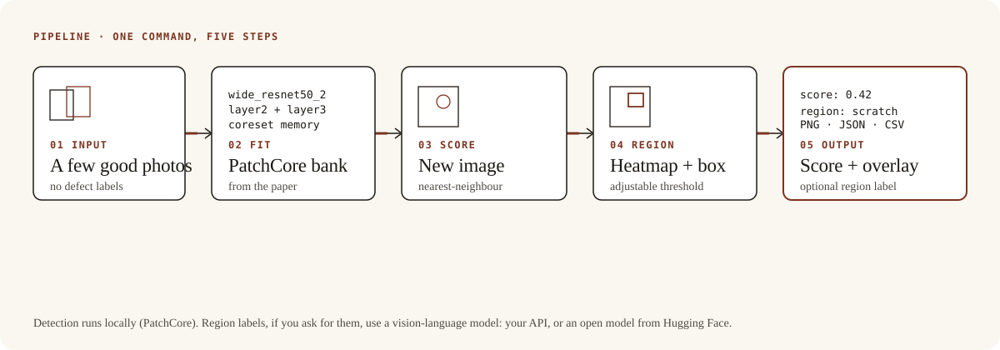
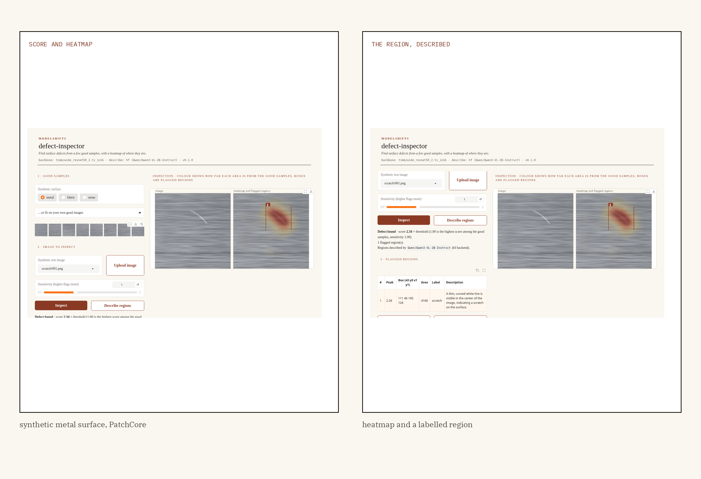

<p align="center">
  
</p>

<p align="center"><strong>A few good photos and a new image go in. A score, a heatmap and the region that looks off come out.</strong></p>

<p align="center">
  <a href="https://github.com/ModelShifts/defect-inspector/actions/workflows/ci.yml"></a>
  
  
  
  
</p>

<p align="center">
  
</p>
<p align="center"><sub>Web demo on a metal surface (<a href="assets/demo.mp4">MP4</a>). Detection is PatchCore with a wide-resnet50 backbone; the optional region label in the recording was computed by Qwen3-VL-2B.</sub></p>

<p align="center">
  
</p>

## The problem

Imagine a short line of parts and a handful of photos of good ones. An inspector looks at each new piece for a scratch, a dent, a stain. There are not enough labelled defects to train a classifier, and a miss is easy when the mark is small.

The useful result is not a model that “sees defects.” It is a score and a heatmap that mark the region that looks off, fitted from a few good samples and no defect labels.

## How it works

The pipeline is five steps. Detection does not need a language model.

1. A few good photos come in — eight, in the samples.
2. PatchCore is fitted on those images: mid-level patches from a wide-resnet50, a greedy coreset memory bank, nearest-neighbour distance as the score. The method is implemented here from the paper; [anomalib](https://github.com/open-edge-platform/anomalib) is not needed.
3. A new image is scored against that bank. The threshold comes from the good training images alone (the highest leave-one-out score).
4. A heatmap and a box mark the region that looks off. A sensitivity slider can loosen or tighten the threshold.
5. You get a score, an overlay PNG, and JSON or CSV. Optionally, a vision-language model can label the region.

<p align="center">
  
</p>
<p align="center"><sub>Detection runs locally. Region labels, if you ask for them, use a vision-language model — your API, or an open model from Hugging Face.</sub></p>

One of the samples, before and after:

<p align="center">
  
</p>
<p align="center"><sub>Metal surface. Image AUROC 1.000, 12/12 defects flagged, 0/6 good images flagged. <a href="scripts/evaluate.py"><code>scripts/evaluate.py</code></a>.</sub></p>

## Results

On three surfaces — metal, fabric and stone — PatchCore with `wide_resnet50_2` flagged **35 of 36 defects**, with image AUROC **1.000, 1.000 and 0.958**. Pixel AUROC was **0.993, 0.993 and 0.957**. One good stone image was flagged (1/18 good test images). Fitting took 2.0–4.6 seconds on eight images; scoring took **0.04–0.05 seconds per image** (detection only).

| Surface | Image AUROC | Pixel AUROC | Flagged defect | Flagged good | Top region | Fit (s) | s / image |
|---|---|---|---|---|---|---|---|
| metal | 1.000 | 0.993 | 12/12 | 0/6 | 12/12 | 4.6 | 0.04 |
| fabric | 1.000 | 0.993 | 12/12 | 0/6 | 12/12 | 2.0 | 0.05 |
| stone | 0.958 | 0.957 | 11/12 | 1/6 | 10/11 | 2.3 | 0.04 |
| **All** | | | **35/36** | **1/18** | **34/35** | **2.0–4.6** | **0.04–0.05** |

**Methodology.** Three surfaces, 8 good training images, 6 good and 12 defective test images per surface (36 defective, 18 good, one defect per defective image). A defect is flagged when its score is above a threshold taken from the good training images. “Top region” counts flagged defects whose highest-scoring region overlaps the ground-truth mask. [`python scripts/evaluate.py`](scripts/evaluate.py). Backbone `timm/wide_resnet50_2.tv_in1k`, 12 November 2026. Detection timings are in [`docs/eval-detection.md`](docs/eval-detection.md). The raw table is in [`docs/eval.md`](docs/eval.md). Samples are in [`samples/`](samples/).

Region labels, scored with Qwen3-VL-2B-Instruct on the Hugging Face backend, were right on **29 of 34** flagged regions that hit the mask (12/12 metal, 8/12 fabric, 9/10 stone). The most common mistake on this set is calling a dent a spot. Labels are a description to help review, not a classification you can rely on. The raw table is in [`docs/eval-hf.md`](docs/eval-hf.md).

## Why it matters

A yes-or-no flag without a place on the image is a rumour. A score with a heatmap is a claim you can look at — from the box back to the scratch, and dismiss it if the box is wrong. That is the difference between a detector you still inspect by hand, and one that can actually help.

It fits anywhere a team already photographs parts and has a few good examples, but not a labelled defect set. Detection runs on your machine with no language model. The optional description can be a hosted API or an open model; the rest of the pipeline stays the same.

## Quickstart

Python 3.11 or newer.

```bash
git clone https://github.com/ModelShifts/defect-inspector
cd defect-inspector
python -m venv .venv && source .venv/bin/activate
pip install torch torchvision --index-url https://download.pytorch.org/whl/cpu   # CPU build; skip on a GPU machine
pip install -e ".[demo]"          # add ",hf" or ",api" for defect descriptions
cp .env.example .env              # backbone and describe backend
```

The feature backbone (about 270 MB) downloads from Hugging Face on first use.

```bash
# learn "good" from 8 defect-free images
defect-inspector fit samples/metal/train/good --out models/metal.npz

# one image: JSON with score and regions, plus the heatmap overlay as PNG
defect-inspector inspect samples/metal/test/scratch/000.png --model models/metal.npz --heatmap out/scratch.png

# a folder to one CSV (or .json), with a heatmap PNG per image
defect-inspector batch samples/metal/test --recursive --model models/metal.npz --out out/results.csv --heatmaps out/heatmaps

# the web demo at http://127.0.0.1:7860 (python app.py does the same)
defect-inspector serve
```

The score is relative to the fitted threshold: `1.0` is the highest score among the good images, each scored against the others. Above `1.0` the image is flagged. `--sensitivity 1.5` flags more, `0.8` flags less.

`samples/` holds the three surfaces, with ground-truth masks. Tests use a stand-in backbone and need no downloads: `pip install -e ".[dev]" && pytest`.

## Backends

<details>
<summary>Detection runs locally. Region labels, optionally, use a vision-language model — your API, or an open model from Hugging Face.</summary>

Detection (fit, score, heatmap) does not call a language model. To label a region, pick a describer with `MS_BACKEND` in `.env`.

| | (a) Bring your own API key | (b) Open-source on Hugging Face |
|---|---|---|
| **What** | Any OpenAI-compatible vision endpoint | Open models, run locally with `transformers` |
| **Set** | `MS_BACKEND=api`, `MS_API_BASE`, `MS_API_KEY`, `MS_VISION_MODEL` | `MS_BACKEND=hf`, optionally `MS_HF_MODEL` |
| **Good for** | Fastest start, hosted models | Data stays on your machines, no per-call cost |

**Default open-source models**

| Model | Used for | License |
|---|---|---|
| [`timm/wide_resnet50_2.tv_in1k`](https://huggingface.co/timm/wide_resnet50_2.tv_in1k) | PatchCore feature backbone | BSD-3-Clause |
| [`facebook/dinov2-base`](https://huggingface.co/facebook/dinov2-base) | alternative feature backbone | Apache-2.0 |
| [`Qwen/Qwen2.5-VL-7B-Instruct`](https://huggingface.co/Qwen/Qwen2.5-VL-7B-Instruct) | describing and labelling the flagged region | Apache-2.0 |
| [`Qwen/Qwen3-VL-2B-Instruct`](https://huggingface.co/Qwen/Qwen3-VL-2B-Instruct) | smaller describer for CPU-only machines | Apache-2.0 |

PatchCore ([Roth et al., *Towards Total Recall in Industrial Anomaly Detection*, CVPR 2022](https://arxiv.org/abs/2106.08265)) is implemented in this repository from the paper. `MS_BACKBONE=facebook/dinov2-base` (or `facebook/dinov2-small`) switches the feature backbone to DINOv2. On a CPU, use Qwen3-VL-2B for descriptions; Qwen2.5-VL-7B needs a GPU.

</details>

## Roadmap

- [ ] Tiling for large images
- [ ] Hosted demo

## License

[MIT](LICENSE) © Modelshifts Technology Pte. Ltd.

<p align="center"><sub>Part of the <a href="https://modelshifts.com/work">Modelshifts</a> showcase. November 2026, v1.</sub></p>
